# Arsitektur Sistem SIAP.PRIORITAS

## Diagram Arsitektur

```mermaid
flowchart LR
    user["Pengguna"]
    browser["Antarmuka Website<br/>React + TypeScript"]
    api["API Client<br/>Axios + JWT"]
    backend["Logika Aplikasi / Backend<br/>Node.js + Express"]
    routes["Routes & Middleware<br/>Validasi, autentikasi, otorisasi"]
    controllers["Controllers<br/>Logika layanan"]
    prisma["Prisma ORM<br/>Prisma Client + PostgreSQL Adapter"]
    database[("Supabase<br/>PostgreSQL")]

    user <-->|"Interaksi"| browser
    browser <-->|"Request/response HTTP"| api
    api <-->|"REST API / JSON"| backend
    backend --> routes
    routes --> controllers
    controllers <-->|"Query dan hasil"| prisma
    prisma <-->|"SQL melalui koneksi PostgreSQL"| database
```

## Alur Kerja

1. Pengguna berinteraksi dengan halaman website SIAP.PRIORITAS melalui browser.
2. Antarmuka React mengirim request ke backend menggunakan Axios. Untuk endpoint yang memerlukan autentikasi, token JWT dikirim pada header `Authorization`.
3. Backend Express menerima request melalui endpoint API, lalu menjalankan middleware yang sesuai, seperti autentikasi, pemeriksaan peran, validasi tanggal, atau unggah dokumen.
4. Route meneruskan request ke controller. Controller menjalankan logika aplikasi dan memanggil Prisma Client untuk membaca atau mengubah data.
5. Prisma ORM menerjemahkan operasi aplikasi menjadi query PostgreSQL melalui adapter PostgreSQL.
6. Supabase PostgreSQL menyimpan atau mengambil data dan mengembalikan hasil melalui jalur yang sama ke antarmuka website.

## Komponen Utama

| Komponen | Teknologi | Tanggung jawab |
|---|---|---|
| Antarmuka Website | React, TypeScript, Vite | Menampilkan halaman dan menerima interaksi pengguna. |
| API Client | Axios | Mengirim request ke API backend dan menyertakan JWT jika tersedia. |
| Backend | Node.js, Express, TypeScript | Menyediakan REST API dan mengoordinasikan proses aplikasi. |
| Routes & Middleware | Express | Memetakan endpoint serta menangani autentikasi, otorisasi, dan pemrosesan request. |
| Controllers | TypeScript | Menjalankan logika untuk autentikasi, kuota, dan reservasi. |
| ORM | Prisma 7 dengan adapter PostgreSQL | Mengakses database secara terstruktur melalui Prisma Client. |
| Database | Supabase PostgreSQL | Menyimpan data pengguna, kuota, reservasi, dan dokumen. |

> Unggahan berkas pada konfigurasi saat ini diproses oleh Multer dan disimpan pada folder `backend/uploads`. Ini terpisah dari alur data PostgreSQL; database menyimpan informasi terkait dokumen.
